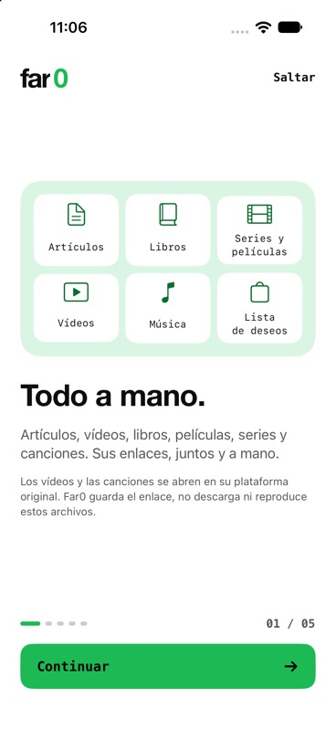
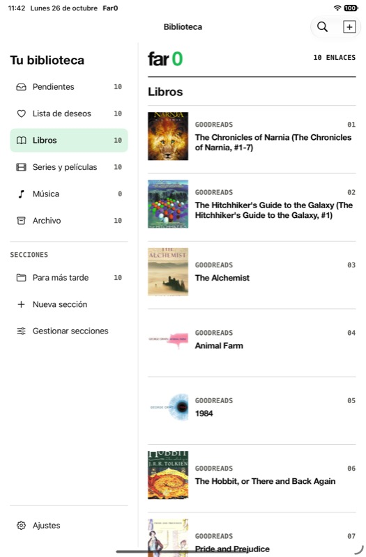

  

# Far0

**Save the link. Find it when you need it.**

A native iPhone and iPad app that brings articles, products, books, films, music and videos into a personal bookmark library. Capture from the share sheet, add a note, organize your links and read compatible articles offline.

Built by [Ignacio Palomares Martín](https://github.com/nachopalomares). This repository presents the product and the engineering behind it. **The application source code is private.**

**Development beta · iPhone & iPad · Spanish app interface**

## See the app

  
  

Screenshots show the running app in iOS simulators. Public links are demonstration content, separate from a personal library. The summary example uses a real, explicitly authorized AI request. The interface is currently Spanish; the documentation is English.

[Browse the screenshots](docs/GALLERY.md) · [Walk through the app](docs/PRODUCT.md) · [Engineering decisions](docs/ENGINEERING.md)

  

## What Far0 does

| Task | Experience |
|---|---|
| Capture quickly | Save a URL in the app or from another app's share sheet, with an optional title, destination and personal note. |
| Keep a useful library | Review the inbox, use wishlists and sections, browse books, films and music, or archive links for later reference. |
| Find something again | Search locally across titles, URLs, descriptions, summaries and sections. |
| Read later | Keep compatible article text on the device for offline reading. |
| Get the gist | Generate an optional article summary after separate permission to send page content to external services. |
| Revisit older saves | Rediscover suggests older links using local metadata, with optional local reminders. |
| Stay in control | Edit notes, choose light/dark/system appearance, manage permissions and recover recently deleted bookmarks. |

The emphasis is on capture and organization. Summaries are an optional aid within that workflow.

## Engineering at a glance

| Area | Technology and approach |
|---|---|
| Native interface | Swift, SwiftUI, adaptive iPhone/iPad navigation |
| Persistence | SwiftData, on-device library, CloudKit disabled |
| Capture across processes | UIKit Share Extension and an App Group handoff queue |
| Web previews | LinkPresentation and source-specific page metadata handling |
| Background work | Asynchronous enrichment with cancellation and recoverable failures |
| Optional article summaries | Supabase Edge Functions, Readability and Groq; provider secrets stay on the server |
| Subscription integration | StoreKit and RevenueCat, currently a development/test flow |
| Reminders | UserNotifications, scheduled locally |
| Optional usage statistics | Explicit opt-in events, excluding bookmark content and personal notes |

The [engineering notes](docs/ENGINEERING.md) explain capture recovery, local data ownership, privacy boundaries and the validation approach without exposing implementation files.

## Current status

Far0 is a development beta. Production purchases remain blocked pending server authorization, a live store catalogue and publication requirements. Any prices shown in screenshots belong to a test environment and are not a live offer.

The library is local to each device. Cross-device sync, video summaries, media downloads, price tracking, universal web extraction and full semantic search are not available. Offline reading depends on whether a page exposes usable article text.

## About this repository

This is a public product showcase for companies and technical reviewers. It contains documentation and selected images, with a history independent of the private development repository. It does not include application source, a buildable Xcode project, backend code, credentials or downloadable app binaries.

For professional enquiries, visit [my GitHub profile](https://github.com/nachopalomares).

© 2026 Ignacio Palomares Martín. All rights reserved. See [NOTICE](NOTICE.md) for asset attribution.
