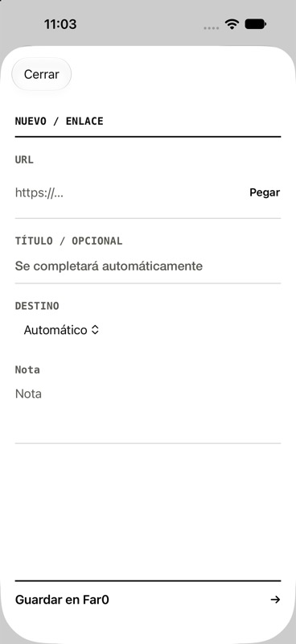
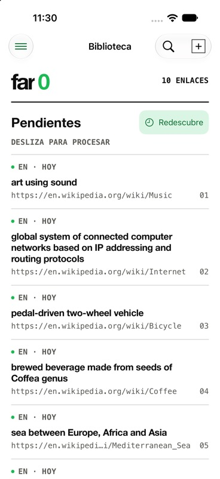
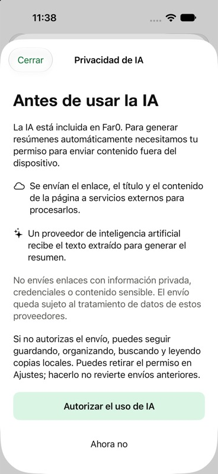
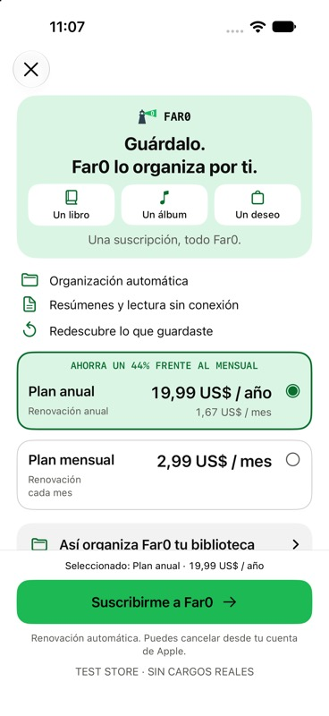

# Far0 in use

[Back to the overview](../README.md) · [Full product walkthrough](PRODUCT.md)

These are captures of the running development app in iPhone simulators, taken on 26 October 2026. The app interface is Spanish. Public links are demo content, separate from a personal library. Screenshots are not design mockups.

## Capture and first launch

  
  

The introduction establishes what can be saved. The capture form keeps the URL central, with optional context and a destination. The same capture workflow is also available through the system share sheet; that extension is described in the walkthrough and is not pictured here.

## A local library of real links

This demo uses public Wikipedia pages, including [Music](https://en.wikipedia.org/wiki/Music), [Internet](https://en.wikipedia.org/wiki/Internet) and [Bicycle](https://en.wikipedia.org/wiki/Bicycle). The displayed titles are the metadata returned by the source, which can differ from the page heading. The capture shows actual extraction behaviour rather than manually reconstructed previews.

## A real article summary

  
  

The example is Google's [Meet Willow, our state-of-the-art quantum chip](https://blog.google/innovation-and-ai/technology/research/google-willow-quantum-chip/). A dedicated demo simulator contained only this bookmark when AI permission was granted. One live summary generation was requested through the app; the resulting Spanish text is shown as returned, without rewriting it for the screenshot. The bookmark title was entered manually. The image shows the beginning of the summary, with more content available by scrolling.

This demonstrates an article summary, not video summarization. An AI summary can contain mistakes and should be checked against its original source.

## A wishlist on iPhone

The wishlist brings together product links with the images and price metadata available from their source pages. This capture includes public [IKEA KALLAX](https://www.ikea.com/es/es/p/kallax-estanteria-blanco-20275814/), [IKEA LACK](https://www.ikea.com/es/es/p/lack-mesa-auxiliar-blanco-30449908/) and [MacBook Air](https://www.apple.com/es/shop/buy-mac/macbook-air) links. Prices are captured page metadata, not current offers or price tracking. A source that does not expose a usable price is labelled accordingly. This is an in-memory demo library with AI permission disabled.

## Subscription preview

The annual total and monthly plan are presented with renewal information. This is RevenueCat Test Store: the USD prices in the image are development values, not a published offer. Production purchases are blocked, and this screenshot does not validate real payments or trial eligibility.

## Coverage and attribution

The images show onboarding, the capture form, an inbox, AI consent, one real summary, an iPhone wishlist and the development subscription screen. Search, the Share Extension, notes, offline reading, Rediscover, recovery and settings are documented in [the product walkthrough](PRODUCT.md); this gallery does not claim screenshots or fresh interactive validation of every feature.

Third-party content remains the property of its respective owners. No affiliation or endorsement is implied. See [NOTICE](../NOTICE.md).
