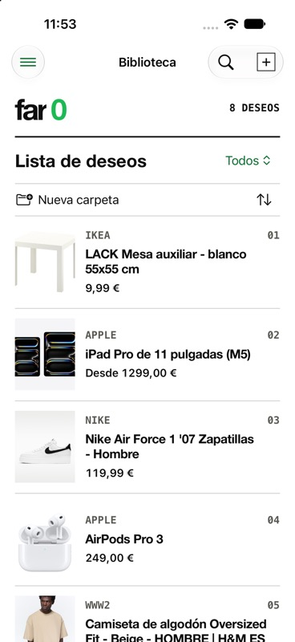
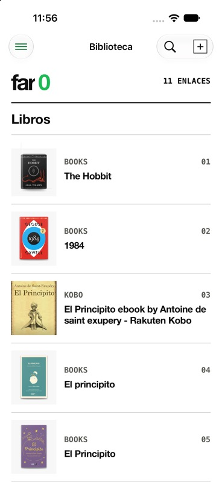
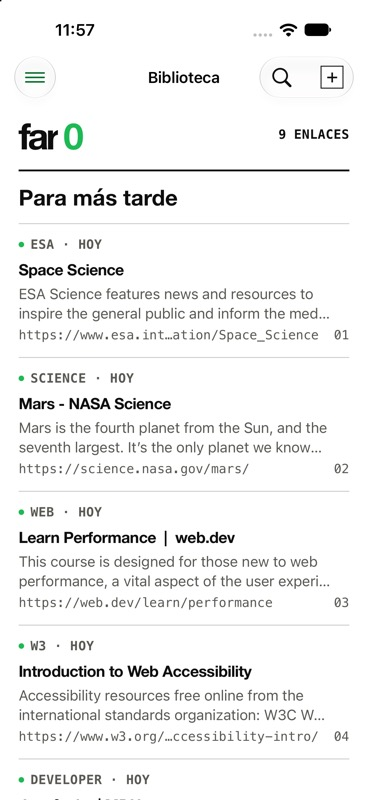
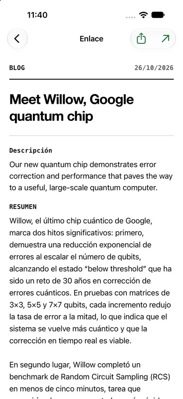

# Far0 in use

[Back to the overview](../README.md) · [Full product walkthrough](PRODUCT.md)

Three collection views and one article detail from the running app in iPhone simulators, captured on 26 October 2026. The collection screenshots show the library; the fourth opens a saved link to show its description and summary. The interface is Spanish; the documentation is English. The links are public demonstration content, separate from a personal library.

## Wishlist: products, photos and prices

The first four products show both their source images and retrieved prices: an [IKEA LACK table](https://www.ikea.com/es/es/p/lack-mesa-auxiliar-blanco-30449908/), [iPad Pro](https://www.apple.com/es/shop/buy-ipad/ipad-pro), [Nike Air Force 1](https://www.nike.com/es/t/air-force-1-07-zapatillas-n8juM1H2/CT2302-100) and [AirPods Pro](https://www.apple.com/es/shop/buy-airpods/airpods-pro-3).

These are page metadata values at capture time, not live offers or price tracking. The demo collection was curated to put products with usable photos and prices together. Availability of either still depends on the source website.

## Books: browse the covers

The collection includes [The Hobbit](https://books.apple.com/us/book/the-hobbit/id360639382), [1984](https://books.apple.com/us/book/1984/id1602697097) and editions of The Little Prince from Apple Books and Kobo. Titles and cover images come from the public source pages. These are saved book links; Far0 does not download the books.

## Websites and articles: saved for later

This view brings together [ESA Space Science](https://www.esa.int/Science_Exploration/Space_Science), [NASA Mars](https://science.nasa.gov/mars/), [Learn Performance](https://web.dev/learn/performance) and [W3C's introduction to web accessibility](https://www.w3.org/WAI/fundamentals/accessibility-intro/). The list shows the source, title, available description and URL before opening a page.

## Inside a saved article: description and summary

The saved link is Google's [Willow quantum chip announcement](https://blog.google/innovation-and-ai/technology/research/google-willow-quantum-chip/). The detail brings together its title, source description and the beginning of a Spanish AI-generated summary. More of the summary is available by scrolling.

This screenshot reuses the previously authorized live demonstration: a dedicated simulator held only this bookmark, and one summary generation was requested through the app. The title was entered manually; the description came from the page and the summary is shown as returned, without rewriting it for the screenshot. An AI summary can contain mistakes and should be checked against the original article.

## Demonstration conditions

The collection demo uses an in-memory library with AI permission disabled. Links whose metadata did not render usefully were archived in that temporary demo library. The screenshots show the resulting app UI, rather than reconstructed cards or invented prices.

Summary processing, capture, notes, offline reading, Rediscover, recovery, access and settings are explained in [the product walkthrough](PRODUCT.md).

These simulator images do not certify physical-device behaviour or production purchases. Third-party content belongs to its respective owners; no affiliation or endorsement is implied. See [NOTICE](../NOTICE.md).
